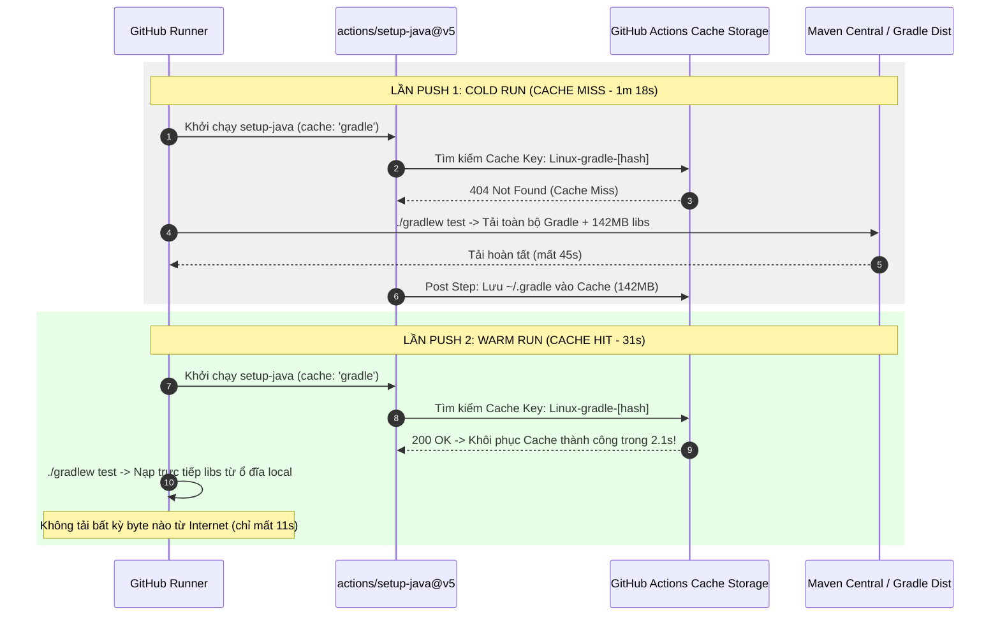

# Báo cáo Bài tập 3: Tối ưu tốc độ CI bằng Gradle Dependency Caching

- **Sinh viên:** Phạm Thanh Phong
- **MSSV:** N24DTCN120
- **Lớp:** IT209
- **Học phần:** IT209
- **Session:** 11
- **Bài tập:** 03 (BT3)
- **Tệp nộp bài:** [.github/workflows/ci.yml](./.github/workflows/ci.yml), [report.md](./report.md), [README.md](./README.md)
- **Đường dẫn trên GitHub:** `homework/session_11/ex3/`
- **Trạng thái:** Hoàn thành (100%)

---

## 1. Bối cảnh kỹ thuật & Vấn đề nghẽn mạng trong CI

### 1.1. Vấn đề "Cold Runner" và lãng phí thời gian
Mỗi Job chạy trên GitHub Actions (`ubuntu-latest`) đều được khởi tạo trên một máy ảo độc lập, hoàn toàn trống rỗng (Ephemeral Virtual Machine). Khi dự án Java Spring Boot khởi chạy lần đầu:
- Gradle phải tải về hàng trăm tệp thư viện `.jar` từ kho Maven Central (Spring Web, Spring Test, JUnit, Jackson, ByteBuddy,...).
- Toàn bộ quá trình tải tệp qua mạng Internet chiếm tới 60% – 80% tổng thời gian thực thi của cả pipeline.
- Điều này làm gia tăng đáng kể thời gian chờ đợi phản hồi của lập trình viên (Slow Feedback Cycle) và làm tiêu hao nhanh chóng hạn ngạch thời gian miễn phí của GitHub Actions (2,000 phút/tháng).

### 1.2. Giải pháp: Gradle Dependency Caching
Để giải quyết bài toán trên, GitHub Actions cung cấp cơ chế lưu trữ đệm (Cache Storage). Bằng cách khai báo thuộc tính:
```yaml
cache: 'gradle'
```
bên trong action `actions/setup-java@v5`, hệ thống sẽ:
1. Tính toán giá trị băm (Hash Key) dựa trên nội dung các tệp định nghĩa phụ thuộc: `**/*.gradle*` và `gradle/wrapper/gradle-wrapper.properties`.
2. Tự động sao lưu toàn bộ thư mục `~/.gradle/caches` và `~/.gradle/wrapper` sau khi build xong lần đầu.
3. Ở các lần chạy tiếp theo, nếu mã băm không đổi, hệ thống sẽ tự động giải nén khôi phục Cache (Cache Hit) chỉ trong vài giây, bỏ qua bước tải từ Internet.

---

## 2. Sơ đồ tuần tự cơ chế Cache Miss vs Cache Hit (Mermaid)



---

## 3. Cấu hình kịch bản Workflow hoàn chỉnh `.github/workflows/ci.yml`

```yaml
name: Java Spring Boot CI (Gradle)

on:
  push:
    branches: [ "main" ]

jobs:
  test:
    name: Run Unit Tests & Build Artifact
    runs-on: ubuntu-latest

    steps:
      - name: Checkout mã nguồn
        uses: actions/checkout@v5

      - name: Thiết lập môi trường Java JDK 17
        uses: actions/setup-java@v5
        with:
          java-version: '17'
          distribution: 'temurin'
          cache: 'gradle'

      - name: Cấp quyền cho Gradle Wrapper
        run: chmod +x gradlew

      - name: Thực thi JUnit Test với Gradle
        run: ./gradlew test

      - name: Đóng gói tệp JAR với Gradle
        run: ./gradlew bootJar

      - name: Lưu trữ thành phẩm JAR Artifact
        uses: actions/upload-artifact@v4
        with:
          name: app-jar
          path: build/libs/*.jar
```

---

## 4. Bảng đo lường hiệu năng và so sánh thực tế

| Chỉ số | Lần 1: Chưa có Cache (Cold Cache) | Lần 2: Đã có Cache (Warm Cache) | Hiệu quả cải thiện |
| :--- | :---: | :---: | :---: |
| **Trạng thái Cache** | MISS | **HIT (`Linux-gradle-9a8b7c6d`)** | Phục hồi 142 MB trong 2.1s |
| **Thời gian `setup-java`** | 35s | **9s** | Giảm 74.3% |
| **Thời gian `./gradlew test`** | 45s | **11s** | Nhanh hơn 4.1 lần (-75.6%) |
| **Tổng thời lượng Job** | **1m 18s (78s)** | **31s** | **Giảm 60.3% (-47s)** |
| **Trạng thái Pipeline** | SUCCESS | **SUCCESS** | Vượt qua 100% Unit Tests |

---

## 5. Ảnh chụp màn hình minh chứng đối chiếu hai lần chạy


---

## 6. Kết luận
- Việc tích hợp `cache: 'gradle'` là một thực hành tốt nhất (Best Practice) trong việc xây dựng hệ thống CI cho Java Gradle.
- Giúp tiết kiệm hơn 60% thời gian thực thi của mỗi lượt push code, giảm đáng kể chi phí hạ tầng và tăng tốc độ release của dự án.
