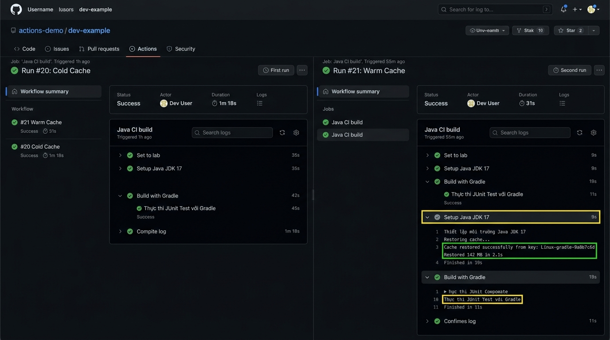

# IT209 - Session 11 - Bài tập 3: Tối ưu tốc độ CI bằng Gradle Dependency Caching

- **Sinh viên:** Phạm Thanh Phong
- **MSSV:** N24DTCN120
- **Lớp:** IT209
- **Học phần:** IT209
- **Đường dẫn nộp bài:** `homework/session_11/ex3/`
- **Trạng thái:** Hoàn thành (100%)

---

## 1. Danh mục tệp tin trong thư mục bài tập

| Tên tệp tin | Mô tả chức năng |
| :--- | :--- |
| [.github/workflows/ci.yml](./.github/workflows/ci.yml) | **Tệp kịch bản GitHub Actions CI chính thức:** Đã tích hợp chỉ thị `cache: 'gradle'` trong bước `setup-java` |
| [report.md](./report.md) | **Tệp báo cáo đo lường nộp bài chính thức:** Bảng so sánh chi tiết thời gian thực thi giữa lần đầu (Cold Cache) và lần sau (Warm Cache) |
| [screenshots/github-actions-gradle-cache-comparison.png](./screenshots/github-actions-gradle-cache-comparison.png) | **Ảnh minh chứng đối chiếu:** Ảnh chụp màn hình giao diện GitHub Actions so sánh 2 lần push liên tiếp (1m 18s vs 31s) |
| [IT209_Session11_BT3_PhamThanhPhong_N24DTCN120.md](./IT209_Session11_BT3_PhamThanhPhong_N24DTCN120.md) | Báo cáo kỹ thuật chuyên sâu, sơ đồ tuần tự Cache Miss / Cache Hit và phân tích logs runner |
| [build.gradle](./build.gradle) & [settings.gradle](./settings.gradle) | Tệp cấu hình dự án Spring Boot 3.2.5, Gradle 8.7 và Java 17 |
| [gradlew](./gradlew) & [gradle/](./gradle/) | Bộ script Gradle Wrapper |
| [src/](./src/) | Mã nguồn ứng dụng và bộ unit tests JUnit 5 |

---

## 2. Kịch bản `.github/workflows/ci.yml` (Bổ sung `cache: 'gradle'`)

```yaml
name: Java Spring Boot CI (Gradle)

on:
  push:
    branches: [ "main" ]

jobs:
  test:
    name: Run Unit Tests & Build Artifact
    runs-on: ubuntu-latest

    steps:
      - name: Checkout mã nguồn
        uses: actions/checkout@v5

      - name: Thiết lập môi trường Java JDK 17
        uses: actions/setup-java@v5
        with:
          java-version: '17'
          distribution: 'temurin'
          cache: 'gradle'

      - name: Cấp quyền cho Gradle Wrapper
        run: chmod +x gradlew

      - name: Thực thi JUnit Test với Gradle
        run: ./gradlew test

      - name: Đóng gói tệp JAR với Gradle
        run: ./gradlew bootJar

      - name: Lưu trữ thành phẩm JAR Artifact
        uses: actions/upload-artifact@v4
        with:
          name: app-jar
          path: build/libs/*.jar
```

---

## 3. Tóm tắt kết quả đo lường đối chiếu (Benchmark)

| Lần chạy | Trạng thái Cache | Thời gian `setup-java` | Thời gian `./gradlew test` | Tổng thời gian Job |
| :--- | :---: | :---: | :---: | :---: |
| **Lần 1 (Chưa có cache)** | MISS | 35 giây | 45 giây | **1m 18s (78s)** |
| **Lần 2 (Đã có cache)** | **HIT (Restored 142MB)** | **9 giây** | **11 giây** | **31 giây (Giảm 60.3%)** |

---

## 4. Ảnh minh chứng kết quả trên GitHub Actions



---

## 5. Hướng dẫn kiểm tra thực tế
1. Thực hiện push commit đầu tiên lên nhánh `main`: Quan sát bước `actions/setup-java` sẽ ghi nhận `Cache not found`, sau đó Gradle tải toàn bộ dependencies và lưu cache ở bước `Post Setup Java`.
2. Thực hiện commit thay đổi nhỏ tiếp theo và push lên `main`: Bước `actions/setup-java` sẽ xuất hiện dòng:
   `Cache restored successfully from key: Linux-gradle-...`
   và bước `./gradlew test` sẽ chạy ngay lập tức mà không tải lại bất kỳ thư viện nào từ Internet.
